  

<h3 align="center">Hola, soy Rodrigo  Estudiante de Ingeniería Informática en la Universidad Complutense de Madrid</h3>

  
  
  

---

## Sobre mí

- Estudio **2º de Ingeniería Informática** en la **Universidad Complutense de Madrid**.
- Programo principalmente en **Java** y **C++**, y trabajo con bases de datos **SQL**.

## Tecnologías

## Contacto

De momento solo en GitHub como **[@rodriserratosa](https://github.com/rodriserratosa)**.

---

  

